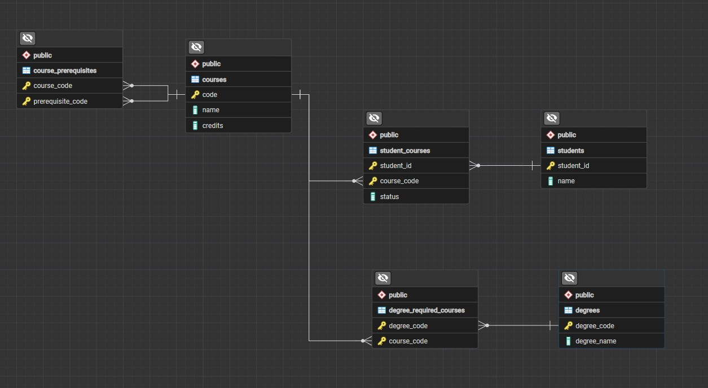

# Graduation Evaluator

This Harry Potter-themed graduation web application helps fictional students evaluate their progress towards completing a specific degree. Students can view the required courses and subsequent prerequisites, check their status of completing the course, and manage their courses as well.

## Project Overview

The user begins by entering their Student ID. For ease of use in our case, I have included the list of available students and their corresponding Student IDs. If an invalid ID is entered, whether the student is not in the database or if the format is incorrect, the application displays an error.

Once a valid Student ID is entered, the user is shown a dropdown of all the available degrees the university provides. The user may select one of these to view all of the required courses to complete that degree. The evaluation shows a quick summary of how many courses are required, how many the student has completed, are in the process of completing, or have not taken yet.

The summary also gets updated if the student adds courses they wish to take or drop courses they are currently taking from the action column of the table. If a student tries to add a course they have not completed the prerequisites for, a pop up appears displaying the prerequisite they need to take first. Additionally, if a student tries to drop a course they are currently taking, a confirmation pops up before they can drop it.

This in-depth evaluation table also displays the details of each required course, such as the course code, the full course name, the course credits each course is valued at, and any prerequisites that are required to take this course.

## Technologies Used

| Technology | Purpose |
|---|---|
| HTML | Page structure |
| CSS | Layout and design |
| JavaScript | Frontend functionality |
| Node.js | Backend runtime |
| Express.js | Server and API routes |
| PostgreSQL | Relational database |
| Neon | Hosted PostgreSQL database |
| pgAdmin | Local database management |
| Git & GitHub | Version control and source code hosting |
| Render | Live application deployment |

## Database Design

The application uses a relational PostgreSQL database to manage students, courses, degree requirements, and course prerequisites.

The application uses six relational database tables:

| Table | Description |
|---|---|
| `students` | Stores student IDs and corresponding name |
| `courses` | Stores available courses (code and full course name) |
| `degrees` | Stores offered degrees (code and full degree name) |
| `degree_required_courses` | Stores each required course for the corresponding degree |
| `course_prerequisites` | Stores each prerequisites any course that has one |
| `student_courses` | Stores students' progress for any course they are taking |

The database uses primary keys, foreign keys, and constraints to maintain data integrity.

## Course Statuses

Each required course is assigned one of three statuses:

- **Completed:** if the student has successfully completed the course (this cannot be set by the student manually)
- **In Progress:** if the student is currently taking the course (the student has the option to drop this)
- **Not Taken:** if the student has no existing record for the course in the student_courses table (the student has the option to add this to the database)

The `not_taken` status is calculated by the application rather than stored in the database.

## Live Application is available at:

https://graduation-evaluator-qyoc.onrender.com/